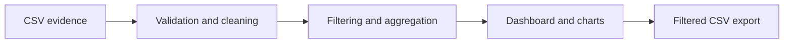

# Commute Insights

Commute Insights is a small, evidence-first dashboard for exploring employee commuting review themes in a MoveInSync-like context. It is designed to help a product or FDE team review public signals, classify them into product themes, and decide which issues deserve internal validation before recommending a product change.

## Project overview

The application loads a curated CSV of public review evidence, validates the file schema and cleaning rules, filters the dataset by theme and confidence, and displays a compact dashboard with charts, a searchable evidence table, and evidence-linked product recommendations.

This project is intentionally careful about scope and language:

- It does not claim to measure prevalence across all users.
- It does not claim a technical root cause from a single review.
- It does not present review counts as a population estimate.
- It does not suggest a rating uplift or product fix without validation.

## Problem statement

Employee transportation apps often surface product friction in areas such as booking confirmation, assigned-trip visibility, live location freshness, ETA reliability, check-in/no-show events, and exception handling. Public reviews may capture symptoms of those issues, but they are never enough by themselves to establish prevalence or causality.

This project turns a narrow evidence sample into a structured and transparent product review workflow, helping teams focus on what should be validated next.

## Why this matters

For employee transport products, confusion around booking steps, inconsistent trip assignment, stale ETA/location data, or unclear no-show handling can directly impact trust and day-to-day usability. However, without internal telemetry, support tickets, and operational evidence, review content should be treated as directional input rather than proof of a systemic issue.

## Features

- Evidence CSV validation with clear failures for missing fields, empty files, and malformed input
- Search and filtering by theme, classification confidence, source/validation status, and date range
- Executive summary cards that describe only the loaded sample
- Theme and confidence charts that are clearly labelled as sample counts
- Compact evidence table with selectable record-level details, source links, and visible caveats
- Downloadable filtered CSV export
- Six recommendation cards traced to evidence IDs and explicitly labelled as requiring validation
- Dedicated methodology and limitations section

## Architecture and data flow



The current implementation includes:

- `app.py` — Streamlit dashboard entry point
- `src/data_loader.py` — CSV validation, schema checks, and filtering
- `src/analysis.py` — aggregation and export helpers
- `src/recommendations.py` — evidence-linked product recommendations
- `data/review_evidence.csv` — curated sample dataset
- `docs/methodology.md` — evidence methodology and limitations
- `tests/` — automated tests for validation and filtering logic

## Tech stack and why it was chosen

- Python 3.10+ — easy to run locally and strong tooling for data workflows
- Streamlit — fast creation of a polished internal dashboard without a frontend framework
- Pandas — robust CSV cleaning, filtering, and tabular analysis
- Plotly — interactive charts for product analysis without heavy overhead
- Pytest — lightweight automated validation for data loading and logic checks

## Installation

### Windows

```powershell
py -m venv .venv
.venv\Scripts\activate
pip install -r requirements.txt
```

### macOS / Linux

```bash
python3 -m venv .venv
source .venv/bin/activate
pip install -r requirements.txt
```

## Run the app

```bash
streamlit run app.py
```

Then open the local URL printed by Streamlit in the terminal, typically:

- http://localhost:8501

## Run the tests

```bash
pytest -q
```

## Dataset schema

The evidence file uses a curated CSV schema with the following expected fields:

| Field | Description |
| --- | --- |
| evidence_id | Stable identifier for each evidence record |
| date_shown | Date displayed with the review or as surfaced in the research snapshot |
| source_locale | Locale or listing context used to identify the source |
| theme | Primary product theme for the signal |
| reported_signal_summary | What the reviewer appears to have reported |
| theme_coding_confidence | Confidence in the coding label for the theme |
| limitations | Known caveats, ambiguity, or evidence limits |
| source_url | Source link for the review or listing |
| validation_status | Whether the record needs internal confirmation |

## Evidence methodology and limitations

The project follows a conservative evidence model:

1. Record each review signal with a source URL and date when available.
2. Preserve the summary and the caveat rather than converting a partial review into a firm claim.
3. Keep the theme label separate from the raw statement so the analysis remains transparent.
4. Do not infer prevalence from sample counts.
5. Require internal validation before treating review themes as product defects.
6. Treat localized or duplicate listing coverage as a source of possible overlap rather than independent unique feedback.

Important limitations:

- This is not a full corpus of reviews.
- A small curated sample cannot establish overall user sentiment or prevalence.
- Public reviews do not prove the underlying technical cause.
- A localized listing may duplicate a review or surface a related item without full context.
- A source with weak verification should be labelled for re-check, not treated as verified evidence.

## Product recommendations and evaluation metrics

The dashboard includes evidence-linked recommendations in the following areas:

1. Clarify booking states and confirmation
2. Prioritise the employee's assigned vehicle
3. Improve GPS and location freshness communication
4. Make check-in and no-show outcomes timely, understandable, and contestable
5. Create actionable exception notifications
6. Connect review themes to support tickets and operational evidence

Each recommendation includes:

- supporting evidence IDs
- problem hypothesis
- proposed intervention
- success metrics
- risks and guardrails
- validation status

These recommendations are explicitly framed as candidate actions requiring validation, not implemented changes to MoveInSync. The evidence explorer keeps source verification status separate from confidence in the theme classification.

## Screenshots

This repository is intentionally structured so you can add genuine screenshots later.

Suggested workflow:

1. Run `streamlit run app.py`.
2. Use the browser to capture a screenshot of the overview, compact evidence table, or record details section.
3. Save images under a `screenshots/` folder.
4. Add them to the README only when they reflect the current project state.

Example:

```text
screenshots/
├── dashboard-overview.png
├── theme-analysis.png
└── evidence-table.png
```

## Deployment on Streamlit Community Cloud

This project is ready for Streamlit Community Cloud with the following assumptions:

- The entry point is `app.py`.
- Dependencies are pinned in `requirements.txt`.
- The project uses relative paths from the repository root.
- No secrets, API keys, or local environment variables are required.

To deploy:

1. Push this repository to GitHub.
2. Open Streamlit Community Cloud.
3. Create a new app from the repository.
4. Set the app file to `app.py`.
5. Confirm the build environment installs the dependencies from `requirements.txt`.

## Known limitations and future improvements

- The project intentionally uses a small curated evidence sample rather than a live review corpus.
- The dataset should eventually be reviewed and expanded by a team with direct access to review sources and internal telemetry.
- Additional validation workflows could include a rule-based categorisation layer, richer support-ticket mapping, and app-version segmentation.

## References and inspiration only

The following GitHub repositories are included only as independent external references for review-analysis workflows. They are not part of this project and are not claimed to be created or owned by the project author.

- https://github.com/AdhithyaR2/play-store-review-analysis
- https://github.com/randalhucker/sentimend
- https://github.com/iamshivam017/ReviewLens

These repositories may illustrate general review-analysis workflows, but their implementation details should be checked carefully before reuse. Any code reuse must comply with the applicable licence and attribution requirements.

## Final note

This project is a focused, honest research prototype designed to demonstrate product thinking, evidence discipline, and practical execution. It supports a thoughtful validation workflow without overstating the evidence or implying a confirmed technical defect or rating gain.
